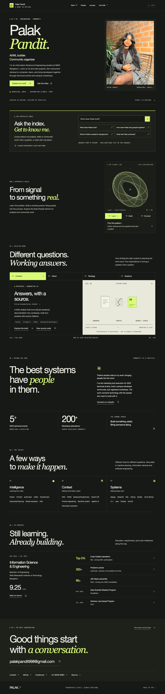

# Signal / Palak

A complete, local portfolio for **Palak Pandit**, shaped around AI engineering and community building. The visual identity uses charcoal, acid lime, warm paper, editorial typography and a custom SVG signal sculpture. All professional claims come from the supplied resume; the phone number and GitHub profile were confirmed in chat.

**Fastest preview:** double-click `OPEN-PORTFOLIO.html`. This standalone edition runs offline, including its interactions and resume download. `Open Portfolio.command` opens the same file on macOS.



## What is included

- A responsive home page: introduction, selected work, community, technical toolkit, education, achievements and contact.
- Four dedicated case-study views with shareable hash URLs, architecture illustrations and documented project scope.
- An interactive signal sculpture with Learn, Build and Connect modes.
- A four-project explorer with accessible arrow-key navigation.
- A Command/Control-K palette with filtering, arrow keys, Enter and Escape.
- A prominent homepage question box directly below the introduction, with suggested questions and answers shown inline.
- A shared local question index grounded in the resume. It is a deterministic lookup, not a live LLM, and handles unsupported questions explicitly.
- A corrected downloadable resume, favicon, social preview, Open Graph metadata, no-JavaScript fallback and an error boundary.
- A production build, offline edition, browser QA script and submission preparation documents.

## Develop

Requires Node.js **20.19+** or **22.12+**, and npm.

```bash
npm ci
npm run dev
```

Open the local address printed by Vite. No environment variables, account connections, backend or API keys are required. No analytics, external fonts, microphone requests or trackers are included.

```bash
npm run typecheck
npm run build
npm run preview
```

The build regenerates `dist/` and `OPEN-PORTFOLIO.html`. `vite preview` is for local checking; deploy `dist/` to a static host for production. See [Vite's static deployment documentation](https://vite.dev/guide/static-deploy.html).

## Edit content

`src/content.ts` contains personal links, project facts, skill categories and question-index answers. `src/App.tsx` contains the editorial page structure. `src/styles.css` contains responsive styling; `src/readability.css` keeps body copy at 16px and small labels at a readable minimum of 12px. Original diagrams live in `src/components/ProjectDiagram.tsx` and `SignalLab.tsx`.

The user supplied project repositories for the RAG chatbot (`RAG_CHATBOT`), E-Store (`ecommerce`) and ChessBot (`chatbot`). These have direct source-code links in the project explorer and case studies. The CIFAR-10 project also links directly to the user-provided `cifar10` repository. Live demos were not supplied. Illustrations are explicitly labelled as architecture studies, not screenshots of the original applications.

There is no formal-employment section because the supplied resume lists no jobs or internships. Joining availability, willingness to travel, personal motivations and first-person lessons were not invented. Add these when Palak confirms them.

The copy in `public/Palak-Pandit-Resume.pdf` preserves the original layout and visible text. Its phone hyperlink was corrected to the number confirmed in chat, `tel:+918252836961`. The original PDF on the Desktop was left untouched.

## Architecture

```text
src/
  content.ts                 Verified data and bounded Q&A answers
  App.tsx                    Page composition, hash navigation and dialogs
  main.tsx                   React entry and error boundary
  styles.css                 Responsive visual system and reduced motion
  fonts.css                  Local system-font alias; no network fonts
  components/
    SignalLab.tsx            Parametric SVG signal sculpture
    Explorer.tsx             Keyboard-accessible project selection
    ProjectDiagram.tsx       Original architecture illustrations
    CaseStudy.tsx            Shared case-study composition
    Dialogs.tsx              Native dialogs, command palette, local index
    IndexQuestions.tsx       Shared homepage/dialog question interface
    Icon.tsx                 Small inline SVG icon set
scripts/
  portable.mjs               Offline single-file build
  seo.mjs                    Domain-specific metadata and sitemap
  qa.mjs                     Browser interaction and accessibility checks
```

React and TypeScript provide a small reusable component system. Vite produces static assets. CSS and SVG handle animation without WebGL or an animation framework. Hash navigation makes all case views work on any static host and in the offline file, without server rewrites. Case views do not have separately indexed path routes or their own social previews.

## Browser checks

```bash
npx playwright install chromium
npm run preview -- --port 4173
```

In another terminal:

```bash
npm run qa
```

The script checks desktop and mobile viewports, project navigation, dialog keyboard use, Q&A fallbacks, local assets, reduced-motion behavior and axe accessibility findings. It also captures screenshots. The actual results from this build are recorded in `QA-REPORT.md`. Automated checks do not replace human accessibility review.

## Deploy

The built `dist/` folder can be deployed on Vercel, Netlify, Cloudflare Pages or another static host. Hosting terms and account costs depend on the provider; no hosting was purchased or activated here.

For Vercel:

1. Put the project in your repository and import it into your Vercel account.
2. Use framework preset **Vite**, build command `npm run build`, output directory `dist`.
3. No environment variables are needed. `vercel.json` includes these build settings and basic security headers.
4. After you know the public domain, run the command below, then rebuild and deploy the updated files.

```bash
npm run seo -- https://your-actual-public-domain
npm run build
```

Use your real domain in that command. It creates a valid domain-specific sitemap and updates canonical/Open Graph URLs. No fake domain or sitemap is shipped. The default social image path is relative until this command sets its absolute public URL.

For a manual static host, upload the **contents of `dist/`**. Check the live site from a signed-out browser, including `#project/gitlab-rag`, mobile navigation and the resume download. The offline preview file is for local convenience; `dist/` is the deployment artifact.

## Challenge preparation

Read `submission/START-SUBMISSION.md` first. The challenge page emphasizes a public new build, genuine Wispr Flow use, a short explanatory recording and a $3,000 setup request. This repository was initially built locally in Codex; it is not represented as already built in Emergent or through Wispr Flow. The included handoff helps you continue authentically in Emergent. Verify the organizer's current interpretation of tooling rules before submission.

Measured local Lighthouse results are in `QA-REPORT.md`; deployed results can differ. No award, acceptance, voice-use proof, public deployment or compliance certification is claimed.

## Asset provenance

The site uses original code-generated SVG diagrams and icons, local system fonts, the user-supplied resume, and the user-supplied portrait (`public/palak-portrait.jpg`). Project interfaces, project screenshots, portraits and logos were not copied from third parties. Screenshots in this folder show this portfolio itself. The local question index makes no network requests.
